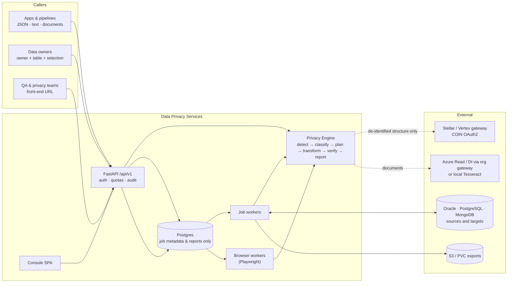

# Data Privacy Services — Design Brief

**Date:** 2026-10-11 · **Status:** Approved for planning — D1–D4 answered 2026-10-11 and folded in below; D5–D14 stand at their stated defaults until overridden ·
**Owner:** Nilendu · **Repo:** `~/document_intelligence/data-privacy-services` (own git repo; upstream not yet created) ·
**Mockups:** [`docs/design/mockups/index.html`](../design/mockups/index.html)

---

## 0. Read me first

This document is three things in one: the research digest (§2), the design (§3–§11), and the decision
record (§12). D1–D4 were answered on 2026-10-11 and are folded into the sections below; D5–D14 stand at their
defaults until you override them. The implementation plan is derived from this document.

The pitch in one line: **one Privacy Engine, three entry points (API, database connectors, UI scanner), two
outcomes (reversible obfuscation, synthetic data), measurable privacy — and a hard rule that no LLM ever sees
raw PII.**

## 1. Summary & goals

Data Privacy Services (DPS) is a stateless, multi-tenant service. A bank team hands it data; it finds the
sensitive values; it returns one of two things:

- **Obfuscated data** — every sensitive value replaced by a token that keeps the field's format and the
  relationships between records, reversible only by the caller holding the key returned in the response.
- **Synthetic data** — every sensitive value replaced by a realistic, locale-correct, internally consistent
  fake, the statistical shape of the non-sensitive data preserved, with no path back to the original.

Three layers feed the same engine:

| Layer | Target | How data arrives | Typical use |
|---|---|---|---|
| **L1 API** | JSON, text, documents (PDF/DOCX/images/CSV) | one HTTPS call | de-identify a payload before a vendor, an LLM or a lower environment sees it; redact a document; mint fixtures |
| **L2 Connectors** | Oracle, PostgreSQL, MongoDB tables/collections | batch job: owner + table + selection → target | masked or synthetic copies of production data for dev/test/analytics; consistent masking across systems |
| **L3 UI scanner** | Web front ends (forms, rendered data) | job: URL (+ auth) → crawl → inventory → parallel view | what PII a UI collects and where; a parallel view of every screen filled with synthetic or obfuscated data, **never submitted**; demo-safe captures |

Three layers × two modes = six capabilities behind one policy model, one detector stack and one
transformation engine. The console (§9) is the showcase surface over all of it.

**v1 goals**

1. Detect PII and client-declared sensitive fields with explainable, per-finding evidence.
2. Reversible obfuscation that preserves format and referential integrity, with keys held by the caller.
3. Synthetic data that is realistic, consistent across fields/tables/systems, and provably free of originals.
4. Batch masking of Oracle/Postgres/Mongo at scale: discover → review → run → evidence.
5. UI form discovery and classification, a parallel filled view of each screen (no submissions), and obfuscated captures.
6. A console that makes all of the above visible and demonstrable in ten minutes.

**v1 non-goals** — not a key-management system (keys are returned or brought by the caller; a KMS-backed
mode is a later option); no database subsetting or virtualisation; in-place writes are an explicit, confirmed
mode and never a default; no differential-privacy *guarantee* claimed (available as an optional engine, §5.6); no redaction
of images/figures beyond text; no entity resolution across tenants; no human-review workflow beyond
accept/override in discovery.

## 2. What the market does — research digest

### 2.1 Product landscape

| Vendor / tool | Positioning | What they do well | What DPS takes from it |
|---|---|---|---|
| **Tonic.ai** (Structural, Fabricate, Textual, Ephemeral) | developer-first test-data platform | one platform spanning structured de-identification, AI-native generation from a schema conversation, unstructured redaction/synthesis; connectors incl. Oracle, MongoDB, PostgreSQL, Snowflake; reviewers flag weak linking of identical synthesized values in text | one engine across structured + unstructured; "generate from schema" as an L1 mode; **keyed consistency as a first-class invariant** (their reported weak spot) |
| **Delphix Continuous Compliance** (Perforce) | enterprise masking | deterministic algorithms consistent across heterogeneous sources and across jobs; segment mapping for keys/IDs; date shifting; lookup substitution; tokenization; format preservation (keep first digits of a card) | an algorithm catalogue + determinism = referential integrity without coordination |
| **K2View** | entity-based masking | masks per business entity (customer) across systems via a micro-database; handles dependent fields (status depends on balance) | entity-centric consistency scope — obtained from keyed determinism rather than a micro-DB; dependent-field rules live in policy |
| **Informatica TDM, Broadcom TDM, IBM Optim** | classic TDM | table-centric masking; discovery often a separate product | discovery → review → apply is table stakes; DPS embeds discovery |
| **Protegrity, OpenText Voltage SecureData, Thales CipherTrust** | vaultless tokenization / FPE | what large banks already run for PAN scope | an **adapter** so DPS can delegate tokenization to a bank-owned service instead of competing for PCI scope |
| **Google Cloud Sensitive Data Protection** | cloud de-identification API | infoTypes; transformations: redaction, replacement, masking, crypto tokenization (deterministic and format-preserving), per-entity date shifting reproducible by key, bucketing, time extraction, dictionary replacement; KMS-wrapped keys | the best public reference model for a transformation catalogue — DPS mirrors it (§5.5) |
| **Microsoft Presidio** | open de-identification SDK | analyzer (pattern + checksum recognizers + spaCy NER), anonymizer operators (replace/redact/hash/mask/encrypt/keep/custom), deanonymizer (decrypt), `presidio-structured` for tables | one detector tier and the operator vocabulary; its default NER recall is weak (§2.3), so DPS ensembles |
| **Gretel (NVIDIA), MOSTLY AI, Synthesized, YData, Hazy** | generative synthetic data | model-based tabular synthesis, privacy reports, DP options; **MOSTLY AI SDK is Apache-2.0, runs locally, TabularARGN, DP option** (released Jan 2025) | a pluggable high-fidelity engine; **SDV is excluded** (Business Source License) |

### 2.2 Technique catalogue — what "obfuscate" and "synthesize" concretely mean

- **Reversible:** format-preserving encryption (NIST SP 800-38G **FF1**; FF3-1 is being withdrawn — NIST's
  Feb 2025 draft revision removed FF3, and the minimum domain is 1,000,000 values), deterministic
  authenticated encryption (**AES-SIV**, RFC 5297), keyed date shifting, vault tokenization (stateful — not us).
- **Irreversible:** HMAC pseudonyms, redaction, partial masking, bucketing/generalisation, nulling,
  dictionary/lookup substitution, noise, suppression.
- **Synthetic:** locale-aware surrogates (Faker/Mimesis), rule-valid identifiers (Luhn-valid cards on test
  BINs, format-valid never-issued SSNs, RFC 2606 reserved e-mail domains, fictional phone ranges),
  distribution-preserving sampling (marginals + Gaussian copula), model-based (TabularARGN, CTGAN/TVAE,
  diffusion), LLM-based (schema-aware text and JSON).

### 2.3 Evidence that shapes the design

- **PII detection.** Presidio's default spaCy recognizers show low recall on public PII benchmarks (REDACT
  multilingual: partial micro-F1 0.195 vs GLiNER 0.32 vs OpenAI Privacy Filter 0.512; Guardrails Index:
  recall 0.39 at good precision). GLiNER-class models trade precision for recall; a GLiNER fine-tuned
  in-domain reached F1 0.98 on clinical notes. **Design consequence:** no single detector. Patterns and
  checksums give precision, NER gives recall, policy picks the operating point, and an in-domain evaluation
  set is a deliverable, not an afterthought.
- **Synthetic tabular data.** A 2024 systematic evaluation found CTGAN the lowest-quality synthesizer tested
  and simple statistical methods competitive or better, especially under differential privacy. 2025 studies
  found zero-shot LLM generation preserved means, confidence intervals and correlations better than CTGAN on
  small, semantically rich tables — but foundation-model generators sit at the high end of
  membership-inference risk (up to 54 % higher TPR at 1 % FPR than the safest deep-learning baseline).
  **Design consequence:** v1 default for tables is a statistical copula engine (fast, auditable, ours); the
  LLM is used only for free text and JSON *from de-identified structure*; model-based engines are optional;
  every synthetic job ships a privacy report in which exact-match leakage must be zero.
- **Regulation.** EDPB Guidelines 01/2025 (pseudonymisation): pseudonymised data remains personal data, and
  pseudonymisation supports Art. 5, 25 and 32 compliance; EDPB 04/2025 sets stricter anonymisation tests.
  India's DPDP Rules were notified on 14 Nov 2025: pseudonymised data stays personal data, anonymised data
  falls outside the Act (no defined standard; EDPB tests are borrowed in practice), 72-hour breach reporting.
  PCI DSS: reversible FPE output stays in scope; tokenization reduces scope only with an isolated, secured
  token system. **Design consequence:** obfuscated output is labelled "pseudonymised — still personal data";
  synthetic output carries a measured anonymity report rather than a claim; every L2 job records purpose and
  legal basis for the audit trail.
- **FPE licensing.** Mysto's `ff3` README notes patent claims on FF1 that allegedly cover open-source
  implementations; `fastfpe` (Rust bindings) implements FF1 and FF3-1; FF3 was removed from the NIST standard
  in the 2025 draft. **Design consequence:** the default reversible primitive is AES-SIV-based deterministic
  tokenization (no FPE patents); FF1 is a pluggable engine behind a license review; bank-owned tokenization
  services get an adapter.

## 3. Design principles

| # | Principle | What it means in the build |
|---|---|---|
| P1 | **The LLM never sees raw PII** | detection and transformation are local and deterministic; the gateway receives only de-identified text (typed placeholders) or structural metadata; a post-transform verifier proves no original value leaked; a per-tenant "raw PII sent to LLM" counter exists and is always zero |
| P2 | **Stateless by default, caller holds the key** | L1 persists nothing; the data-encryption key is returned in the response (optionally wrapped with the caller's public key); L2/L3 persist job metadata and reports, never raw values; the service never stores a reveal key |
| P3 | **Deterministic and referentially consistent** | the same input under the same key gives the same token in every field, table, system and job; consistency scope is explicit (request, key, entity) |
| P4 | **Format and semantics preserved** | numeric IDs stay numeric and the same length, dates keep order and intervals, e-mails stay e-mails, surrogates match locale, gender and age band |
| P5 | **Policy-driven and explainable** | every finding names its detector, score and the rule that decided its treatment; policies are versioned artefacts with presets (PCI, GDPR-pseudonymise, DPDP, analytics-safe) |
| P6 | **Measurable** | every job emits an evidence pack: findings, methods, fidelity and privacy metrics, verification result, configuration hash |
| P7 | **One engine, three adapters** | L1/L2/L3 differ only in how records arrive and leave; the engine API is the same `transform(records, policy, key)` |
| P8 | **Fail closed** | unknown field types in a strict policy are redacted, verification failures fail the request, production posture refuses unsafe configuration at boot |

## 4. Architecture



**Processes (one image, four roles):** `app` (API + console; serves L1 with no database at all), `worker`
(L2 jobs), `browser-worker` (L3 jobs; Playwright Chromium baked in), `migrate` (DDL as a separate role, as
in Document AI Services). `db` is Postgres 16 holding tenants, keys (hashed), jobs, checkpoints, reports and
the append-only audit log — never customer values. The local stack adds `oracle-free`, `mongo`,
`postgres-source`, `minio` and the existing Azure OCR mock so every layer runs end to end offline.

**Statelessness, precisely.** L1 requests touch no storage; `/readyz` reports `api-core` ready even when the
database is down (only `jobs` degrades). L2/L3 need durable job state, so they use the durable
Postgres-native queue proven in Document AI Services (`FOR UPDATE SKIP LOCKED` claims, leases, heartbeats,
reaper, dead-letter, per-tenant caps). What is stored for a job: specification (secrets encrypted or by
reference), classification snapshot (column names, inferred types, masked examples), progress checkpoints
(last key per partition), the evidence report. Retention is a tenant policy (default 30 days).

**Request path, L1 obfuscate.** authenticate (X-API-KEY → tenant, scopes) → quota and size checks → parse
input (JSON / text / document → canonical records with paths or spans) → detect (§5.3) → resolve policy
(§5.4) into a plan: one method per finding → transform (§5.5) → verify (§5.7) → respond with result,
findings, key material, report → audit record (counts and hashes only).

## 5. The Privacy Engine

### 5.1 Core model

- `Record` — a JSON-like tree (L1 JSON, L2 row, L2 Mongo document, L3 form) or a `Text` with spans.
- `Finding` — `{locator (path | span | page+bbox), entity_type, score, detectors[], sensitivity, evidence}`.
- `Policy` — what to look for, how sure to be, what to do per entity type, consistency scope, locale.
- `Plan` — the resolved `Finding → Method` table for one request, with reasons; it is what the console
  shows and what the report records.
- `KeyMaterial` — `{alg, kid, dek | wrapped_dek, consistency_scope, created_at}`; never persisted by DPS.
- `Report` — findings summary, methods used, verification result, fidelity/privacy metrics, config hash.

### 5.2 Entity taxonomy (v1)

| Family | Entity types (validators in brackets) |
|---|---|
| Identity | `PERSON_NAME`, `DATE_OF_BIRTH`, `GENDER`, `NATIONALITY`, `AGE` |
| Government IDs | US `SSN` `ITIN` `EIN` `PASSPORT` `DRIVER_LICENSE`; CA `SIN` `BN`; MX `CURP` `RFC` `INE_CLAVE`; IN `AADHAAR` (Verhoeff) `PAN` `VOTER_ID` `PASSPORT`; UK `NINO` `NHS_NUMBER`; EU national IDs subset; ICAO `MRZ` — all via `python-stdnum` where a checksum exists |
| Financial | `CARD_PAN` (Luhn) `CARD_EXPIRY` `CVV` `IBAN` (mod-97) `SWIFT_BIC` `ACCOUNT_NUMBER` `ROUTING_ABA` `IFSC` `SORT_CODE` `CRYPTO_ADDRESS` `AMOUNT` |
| Contact | `EMAIL` `PHONE` `STREET_ADDRESS` `POSTAL_CODE` `CITY` `GEO_COORDINATE` |
| Online | `IP_ADDRESS` `MAC_ADDRESS` `URL` `USERNAME` `DEVICE_ID` `COOKIE_ID` |
| Secrets | `API_KEY` `PASSWORD` `JWT` `PRIVATE_KEY` (a bank-relevant extra: leaked credentials in payloads and logs) |
| Health (optional pack) | `MEDICAL_RECORD_NUMBER` `DIAGNOSIS_CODE` `MEDICATION` |
| Organisation | `ORG_NAME` `EMPLOYEE_ID` `CUSTOMER_ID` `CASE_ID` — and any **client-declared** type via custom recognizers or explicit field lists ("more than PII") |

Sensitivity tiers reuse the Document AI Services ladder — LOW / MEDIUM / HIGH / CRITICAL — with any
government or card identifier CRITICAL and co-occurrence rules (name + DOB + address) raising a record's tier.

### 5.3 Detectors — a scored ensemble

| Tier | Detector | Signal | Cost |
|---|---|---|---|
| T0 | **Structural** | JSON key paths, column names, HTML `autocomplete` tokens, labels, declared schema types — a multilingual name dictionary (`ssn`, `nss`, `aadhaar_no`, `fecha_nac`…) | free |
| T1 | **Patterns + checksums** | regex catalogue per type and jurisdiction, validated by `python-stdnum`, Luhn, Verhoeff, mod-97; context words (EN/ES/HI transliterations) raise or lower scores | microseconds |
| T2 | **NER** | Presidio analyzer with spaCy (`en`, `es`) as the baseline; optional GLiNER-PII multilingual model as a higher-recall tier; both lazy-loaded, both optional extras | milliseconds per text |
| T3 | **LLM-assisted labelling** (opt-in) | the gateway classifies *field metadata* — names, types, a few de-identified or synthetic sample values — to resolve semantic types for ambiguous columns; it never receives raw values | seconds, per column not per row |
| T4 | **Client declarations** | explicit field lists, custom recognizers (YAML in Presidio's recognizer shape — the format DES already uses), deny-lists | free |

Scores combine as a noisy-OR per locator with detector weights from policy; ties resolve by specificity
(a validated CURP beats an RFC regex on the same span — the rule already proven in `di/gate/pii.py`). Every
finding keeps the list of detectors that fired, so a reviewer sees *why*.

An **evaluation harness** ships with the engine: a labelled synthetic corpus per jurisdiction (generated by
the surrogate engine itself, so it contains no real PII) plus a slot for the bank's own labelled samples;
`tools/eval_detectors.py` prints precision/recall per type so detector or threshold changes are measured.

### 5.4 Policy model

```yaml
policy: gdpr-pseudonymise        # preset, overridable field by field
version: 1
locale: { default: en_US, by_country_field: address.country }
detect:
  tiers: [structural, patterns, ner]      # llm_label opt-in
  min_score: 0.6
  custom_recognizers: [ { name: employee-id, supported_entity: EMPLOYEE_ID,
                          patterns: [ { regex: "\\bEMP-\\d{6}\\b", score: 0.9 } ] } ]
  declared_fields:                           # "more than PII": anything the owner names
    - { path: "$.loan.internal_score", entity_type: BUSINESS_SENSITIVE }
treat:                                       # entity_type -> method (+ params)
  default_sensitive: { method: det_token }   # unknown sensitive → reversible token
  SSN:        { method: fpe_digits, keep_suffix: 4 }
  CARD_PAN:   { method: fpe_digits, keep_prefix: 6, keep_suffix: 4 }
  EMAIL:      { method: email, domain: keep }
  DATE_OF_BIRTH: { method: date_shift, window_days: 365, anchor: "$.customer_id" }
  PERSON_NAME: { method: fpe_text }          # natural-looking, reversible
  BUSINESS_SENSITIVE: { method: bucket, ranges: [0, 300, 600, 900] }
  AMOUNT: { method: keep }
consistency: { scope: key }                  # request | key (caller passes key back) | entity
output: { token_style: natural }             # natural | envelope
verify: { leakage_check: strict }
```

Presets ship as files: `pci-dss`, `gdpr-pseudonymise`, `dpdp-pseudonymise`, `analytics-safe`
(irreversible, generalised), `synthetic-realistic`, `synthetic-strict`.

### 5.5 Obfuscation methods

**Key material.** Per request DPS generates a 256-bit data-encryption key (`dek`). Per-method, per-type
subkeys come from `HKDF-SHA256(dek, salt=kid, info="dps.v1|method|entity_type[|field_path]")`. The response
carries the key in clear (base64url) **or** wrapped with a caller-supplied RSA-OAEP-256 / X25519 public key,
so the plaintext key need never cross the wire. DPS does not store it. A caller who passes the same key
material back gets the same tokens — that is how consistency spans calls, jobs and systems (P3).

| Method | Reversible | How | Preserves |
|---|---|---|---|
| `fpe_digits` | yes | FF1 (radix 10) over the digit positions; separators, `keep_prefix`, `keep_suffix` untouched; tweak = entity type (+ field path when field-scoped); **requires ≥ 6 free digits (domain ≥ 10⁶) else falls back to `det_token`** and says so in the plan | length, format, partial visibility |
| `fpe_text` | yes | FF1 over character classes (lower 26 / upper 26 / digit 10 / mixed 62) position by position; punctuation and spaces kept; minimum-domain guard as above | length, case pattern, "looks like a name" |
| `det_token` | yes | AES-SIV (RFC 5297, `cryptography.AESSIV`) with associated data = entity type; base32 token; in text, emitted as an envelope `[[PII:EMAIL:k7fq2wxb3n]]`; in JSON, as the value | nothing but determinism — the safe default for any domain size |
| `email` | yes | local part via `fpe_text`; domain `keep` / `generalize` (`example.com`) / `encrypt` | mailbox shape |
| `phone` | yes | `fpe_digits` with `keep_country_code` | dialable shape |
| `date_shift` | yes | per-record offset `HMAC(subkey, anchor_token) mod (2W+1) − W`; all dates in the record shift equally; the anchor is the record's own token, so reveal recomputes the offset without the original | order, intervals, age bands |
| `hmac_pseudonym` | no | HMAC-SHA256 with a pepper returned once as key material; truncated base32 | join-ability, nothing else |
| `mask_partial` | no | `****-**-4421` | last-4 visibility |
| `redact` / `null` | no | removes the value (documents: true redaction when a PDF is produced) | — |
| `bucket` / `generalize` | no | ranges, year-only dates, city-only addresses | analytical shape |
| `dictionary` | no | lookup replacement from a caller list | domain vocabulary |
| `noise` | no | additive/multiplicative noise within bounds | aggregate statistics |
| `external_tokenize` | depends | adapter to a bank tokenization service (Voltage / Protegrity / Thales) with the same method interface | whatever the service preserves |

**FPE engine.** `fastfpe` (FF1) behind the `fpe` optional extra and a license review (§2.3); until approved,
`fpe_*` methods degrade to `det_token` and the plan says `fpe_unavailable`. The crypto core
(`dps/engine/transform/crypto.py`) is the one module that touches keys; it logs nothing and has no debug paths.

**Token styles.** `envelope` (default for text: robust, self-describing, reveal needs no hints) and
`natural` (format-shaped; reveal uses the `reveal_hints` span list DPS returns, which contains locators,
methods and types but never originals).

**Reveal.** `POST /api/v1/reveal {data, key_material, reveal_hints?}` decrypts in one pass. It is the same
stateless engine run backwards; reveal is a separate scope so most keys cannot call it.

### 5.6 Synthesis methods

**Surrogates (PII fields).** A `synthesis_seed` (256-bit, per request unless the caller passes one back)
drives every generator: the surrogate for value `v` of type `T` is `generator_T(seed = HMAC(seed, T‖canon(v)))`.
Same original → same fake, across fields, tables and systems. Generators are locale-aware (Faker and
Mimesis providers, extended for IN/MX/CA/UK) and **rule-valid**: Luhn-valid cards on IIN test ranges,
never-issued SSNs (area 900–999 / 666 / 000), Verhoeff-valid Aadhaar-shaped numbers outside issued space,
RFC 2606 e-mail domains, 555-01xx / Ofcom drama phone ranges, real-looking but unregistered street
addresses. A **persona** is derived once per record from its anchor so name, gender, e-mail, DOB, locale and
address agree. The seed is not a reveal key (generation is one-way) but it does allow linking if an
attacker holds both the seed and candidate originals, so it is treated as confidential and `consistency: none`
is available.

**Tabular shape (non-PII columns, L2).** The built-in copula engine fits each column's marginal (empirical
quantiles for numerics and dates, frequency tables for categoricals with rare categories collapsed below a
configurable floor, null rates kept), fits a Gaussian copula on rank-transformed data for correlations, samples,
inverse-transforms, then applies constraints: ranges, positivity, uniqueness for keys, dependent-field rules from
policy (`status = f(balance)`), parent/child cardinality for FK tables. It is NumPy/SciPy code we own, auditable
and fast. **Optional engine:** the MOSTLY AI SDK (Apache-2.0, local mode, TabularARGN, differential privacy
option) behind the `synth-ml` extra for higher fidelity, multi-table and sequential data.

**Free text and documents (L1, L2 text columns).**
1. detect → 2. replace findings with typed placeholders `{PERSON_1}`, `{DATE_2}` → 3. *optional* LLM pass via
the gateway: "rewrite as a different but equally plausible instance; keep the placeholders; keep structure,
tone and length" (temperature 0.7) → 4. fill placeholders with persona-consistent surrogates (DPS chooses the
fakes, never the model, so consistency holds) → 5. verify: re-run detectors and match normalised originals
against the output; any hit fails closed to the deterministic path → 6. return with report.
The model therefore never sees a raw value and never invents one.

**Synthesize from schema (L1).** Given a JSON schema, DDL or a de-identified sample, the gateway proposes a
*generator spec* per field (`{"txn_amount": {"generator": "lognormal", "params": {...}}}`); the engine
executes it deterministically; the spec is a reviewable, reusable policy artefact. This is the "Fabricate"
capability without the model touching data.

### 5.7 Verification and evidence

Every response and job carries a report: findings by type and tier; the plan with reasons; **leakage sweep**
(no original sensitive value present in output — exact and normalised match, plus detectors re-run on the
output); for synthetic output, **fidelity** (per-column KS statistic for numerics, total-variation distance for
categoricals, correlation-matrix delta, null-rate delta), **utility** (optional train-on-synthetic /
test-on-real for a nominated label), **privacy** (exact-row matches = 0 enforced, nearest-neighbour distance
ratio synthetic→real vs real→real, quasi-identifier uniqueness, a membership-inference proxy when the ML engine
is used); configuration hash and software versions. L2 jobs render this as a downloadable evidence pack
(JSON + printable HTML/PDF).

## 6. Layer 1 — the API

| Endpoint | Purpose |
|---|---|
| `POST /api/v1/detect` | findings only, no transformation (inspection, dry runs, "what would you do") |
| `POST /api/v1/obfuscate` | reversible or irreversible transformation per policy; returns key material |
| `POST /api/v1/synthesize` | synthetic replacement; optional seed echo for consistency |
| `POST /api/v1/reveal` | de-obfuscate with the caller's key material (separate scope) |
| `POST /api/v1/documents/{detect\|obfuscate\|synthesize}` | multipart PDF/DOCX/PNG/JPEG/TXT/CSV; returns text output, per-page findings, optional redacted PDF |
| `POST /api/v1/schema/synthesize` | synthesize rows from a schema or de-identified sample via a generator spec |
| `GET /api/v1/policies/presets` · `POST /api/v1/policies/validate` · `POST /api/v1/policies/plan` | policy tooling; `plan` returns the resolved plan for a sample without transforming |
| `GET /health` · `GET /readyz` · `GET /metrics` | liveness; per-dependency readiness (`api-core`, `db`, `llm-gateway`, `ocr`, `browser`); Prometheus |

Request envelope: `{ "data": <json> | "text": "<str>", "policy": "<preset>" | {<inline>}, "options":
{ "consistency": {...}, "token_style": "...", "locale": "...", "wrap_key": {"type": "rsa-oaep-256",
"public_key_pem": "..."} } }`. Response: `{ "result", "findings[]", "key_material"?, "synthesis_seed"?,
"reveal_hints"?, "report", "trace_id" }`. Arrays stream as NDJSON when large; `Idempotency-Key` is honoured;
limits (payload MB, items, text length) mirror the sibling services and are posture-checked.

Documents: PDF text layer via `pypdf`; scanned pages and images via the Azure Read/DI contract through the
org's gateway (same wire contract the siblings target) or local Tesseract when unset; DOCX via `python-docx`;
CSV as records. A redacted PDF (true redaction: text removed, box drawn) uses `pdfplumber` coordinates with
`pypdf`/`reportlab` overlays — no PyMuPDF (AGPL). Obfuscated text is reversible; a redacted PDF is not, by design.

## 7. Layer 2 — connectors and batch jobs

**Lifecycle.** `discover` → review in the console (or accept via API) → `run` → evidence. A job specification:

```json
{
  "mode": "obfuscate",
  "source": { "engine": "oracle", "connection": { "secret_ref": "dps/src/crm-prod-ro" },
              "owner": "CRM", "table": "CUSTOMERS",
              "selection": { "where": "CREATED_AT >= DATE '2025-01-01'", "columns": null, "max_rows": null },
              "parallelism": 8 },
  "target": { "kind": "table", "connection": { "secret_ref": "dps/tgt/crm-uat" },
              "owner": "CRM_MASKED", "table": "CUSTOMERS",
              "create_if_missing": true, "write_mode": "truncate_insert" },
  "policy":  { "preset": "gdpr-pseudonymise", "overrides": { "CUSTOMERS.RISK_SCORE": { "method": "bucket" } } },
  "consistency": { "scope": "key", "key_material": { "...": "from a previous job, for cross-system joins" } },
  "purpose": { "ticket": "CHG-48213", "legal_basis": "legitimate interest — UAT provisioning" },
  "options": { "checkpoint_every_rows": 50000, "dry_run": false }
}
```

**Selection ("control statement").** `where` (an expression, bound parameters only), `query` (a full
`SELECT`, must be read-only and keyset-able), `columns`, `max_rows`, `sample`. Statements are parsed with
`sqlglot`: one statement, `SELECT` only, no DML/DDL/`INTO`/procedures; identifiers are validated with the
Oracle identifier rule from the Wega orchestrator before they are ever interpolated. Mongo filters are JSON
validated against an operator allow-list (`$where` and friends rejected).

**Write modes (decision D3).** Four, chosen per job:

| `write_mode` | What happens | Notes |
|---|---|---|
| `in_place` | the selected rows are **updated in the source table** by primary key, column by column, in committed batches | obfuscate or synthesize; the key material is returned to the caller for obfuscate; requires `confirm_write: true` in the API and a confirmation step with row counts in the console; connections tagged `production` additionally require the `admin` scope |
| `append` | transformed copies of the selected rows are **inserted as new rows** — into the same table or a named table | needs a primary-key strategy: `generate` (database identity/sequence/default, Mongo new `_id`), `offset` (add a configured offset or prefix), or `token` (the obfuscated key, with a pre-flight collision check that aborts the job on any clash); the evidence pack records which strategy ran; `confirm_write: true` as above |
| `table` | load into a destination table/schema of the same engine (created from the source definition when missing); `truncate_insert` or `upsert` on the primary key | the classic masked-copy provisioning path |
| `files` | CSV / Parquet / JSONL to S3 or a PVC path with a manifest | hand-off to other loaders and analytics |

```json
"target": { "write_mode": "in_place", "confirm_write": true }
"target": { "write_mode": "append", "table": "CUSTOMERS", "pk_strategy": { "kind": "offset", "offset": 90000000 }, "confirm_write": true }
```

`in_place` and `append` run inside the source connection's transaction scope with the same checkpointing as
the other modes, so a failed partition resumes from its last committed batch and never half-applies a row.

**Discovery.** Sample `n` rows per column (`TABLESAMPLE` / Oracle `SAMPLE` / Mongo `$sample`), run the
detectors, infer a semantic type per column from T0 names plus value evidence, and store a *classification
snapshot* (column, inferred type, confidence, masked examples, suggested method). The console's review page
lets the owner accept or override; the accepted snapshot becomes the run policy and is part of the evidence.

**Execution.** Partition the key space (numeric/UUID primary-key ranges; Oracle can also chunk by ROWID
ranges) into durable queue rows; workers claim partitions, read in batches, transform through the engine,
write in batches, and checkpoint the last key per partition after every committed write, so a retry or a
restart resumes instead of restarting. Writes are idempotent (upsert on PK, or per-partition truncate-and-
reload). Per-tenant running caps and the reaper come from the proven queue design.

**Engine notes.**
- *PostgreSQL* — `asyncpg`; `BEGIN READ ONLY`, `statement_timeout`; keyset by PK; `COPY` for target loads.
- *Oracle* — `python-oracledb` thin mode; the Wega pool rules (`expire_time=1`, `call_timeout`,
  `tcp_connect_timeout`, `module/action/client_identifier` tagging so the DBA's audit sees DPS); raw cursor with
  `arraysize = prefetchrows = batch`; CLOB offsets are UTF-16 units, CHAR columns need fixed-length binds,
  TIMESTAMP precision beyond microseconds is paged carefully — all three were measured bugs in Wega and are
  carried in as tests; never `FOR UPDATE`.
- *MongoDB* — `motor`; keyset on `_id`; each document is transformed by the L1 JSON engine (nested paths, arrays);
  `bulk_write(ordered=False)` to the target collection; index copy optional.

**Cross-system consistency.** One key material across a *job group* with entity-scoped tweaks makes the
customer id, e-mail and SSN agree across the Oracle CRM table, the Mongo profile collection and the Postgres
ledger — the K2View property without a micro-database. The console demonstrates it with a three-way join.

**Credentials.** Production path: `secret_ref` naming a mounted secret (the job stores only the name). Dev
path: inline credentials over TLS, encrypted at rest with a service key (`DPS_JOB_KEK`, 32 bytes from the
secret store) and purged on completion; never logged; a `test-connection` endpoint runs the least-privilege
checks (SELECT on source, CREATE/INSERT on target) before a job is accepted.

**Throughput.** Transforms are microseconds per value; cost concentrates in source reads and NER on free-text
columns, so NER runs only on columns the snapshot classified as text. Per-worker throughput is a measured
number from the simulator in M2 (`tools/bench_connector.py`), not a promise made here.

## 8. Layer 3 — UI scanner

```json
{ "url": "https://onboarding-uat.bank.internal/apply",
  "scope": { "same_origin": true, "max_pages": 50, "max_depth": 3, "deny": ["/logout", "/admin"] },
  "auth": { "storage_state_ref": "dps/ui/onboarding-uat" },
  "mode": "synthesize",
  "fill": { "personas": 20, "locale": "en_IN" },
  "parallel_view": true,
  "capture": { "screenshots": true, "har": false } }
```

**Crawl.** Playwright Chromium in the `browser-worker`; same-origin, depth and page budgets; SPA routes
discovered by clicking in-scope links; open shadow DOM and same-origin iframes included. For every page: forms
and fields (tag, type, name, id, label via `<label for>` / `aria-label` / `aria-labelledby` / placeholder /
nearest text, `autocomplete` token, `pattern`, `maxlength`, `required`, select options), a screenshot with
numbered field overlays, and the rendered text.

**Classify.** The HTML `autocomplete` token is the strongest signal (`name`, `given-name`, `email`, `tel`,
`street-address`, `postal-code`, `cc-number`, `cc-exp`, `cc-csc`, `bday`, `sex`, `username`,
`new-password`, `one-time-code`…) and maps directly to entity types. Fields without tokens fall back to the
structural dictionary (label/name/placeholder, EN/ES/HI), input type and pattern; pre-filled or rendered values
go through the value detectors; T3 metadata labelling is available for the leftovers. Output: a **form data
inventory** (page, form, field, label, inferred entity, sensitivity, confidence, evidence) plus risk flags —
autocomplete enabled on sensitive fields, password fields without `new-password`, PII in URL query strings, PII
rendered in tables.

**Parallel view — no submissions, ever (decision D4).** DPS never submits a form: there is no submit option
in the API or the console, and the browser worker installs a request interceptor that blocks any form POST
or non-GET navigation originating from a filled page, as defence in depth. For each discovered page the worker
fills the fields with the *corresponding modified data* — persona values from the surrogate engine in
synthesize mode, reversible tokens in obfuscate mode — and captures the result. The console renders the
**original screen beside the filled screen**, field by field, with the entity chip, the method and the value
mapping, and records any client-side validation messages as evidence that generated values satisfy the UI's
own format rules. Results export as CSV/JSON (the persona set and the field→entity→value mapping) for QA
automation to replay in its own harness.

**Obfuscate.** For pages that render data (profile pages, tables), DPS replaces PII in the extracted text and
produces masked screenshots and DOM text with a reversible map — demo-safe captures and bug reports.

**Safety rails.** No submission path exists in code; scope allow/deny lists; page and time budgets;
credentials and storage state held only in worker memory for the job's duration; every navigation audited;
no crawling outside the tenant's registered hosts.

## 9. The console

**Information architecture**

| Page | Purpose | Key elements |
|---|---|---|
| **Overview** | protection posture at a glance | KPI tiles (values protected today, PII found by type, jobs running, **raw PII sent to LLM: 0**), posture gauge, 14-day trend, recent jobs, three layer cards with live counts |
| **Playground** (L1 hero) | show the engine in seconds | three panes: input (paste JSON/text, drop a file) → findings with entity chips and detector evidence → output with Obfuscated / Synthetic toggle, side-by-side diff, key-material card, **Reveal** demo, "copy as curl" |
| **Policies** | the control surface | presets, per-entity action matrix, custom recognizer builder with live test, plan preview on a sample, versions |
| **Data sources & jobs** (L2) | connector wizard and operations | connect → discover → review (column heat-map, accept/override) → target → run; job detail with partition progress, throughput sparkline, checkpoints, evidence pack; job groups for cross-system consistency |
| **UI scanner** (L3) | crawl, inventory, parallel view | URL + auth → crawl map → annotated screenshots with field chips → inventory table → **parallel view** (original screen beside the same screen filled with synthetic or obfuscated data, never submitted; toggle synthetic/obfuscated) → obfuscated captures → export |
| **Reports & audit** | evidence | evidence packs, verification results, who ran what and when, exportable PDF |
| **Admin** | tenancy | API keys and scopes, tenants and quotas, retention, health |

**Design direction — "Vault".** A new identity in the same token discipline as the Document AI Services
console (semantic tokens, light and dark, no raw palette in components): deep ink surfaces, a cool paper
light mode, and a small set of *signal* colours with fixed meaning — teal = protected, amber = detected /
needs a decision, emerald = verified, rose = critical / leak. Signature components: the **entity chip**
(type + token, evidence on hover, reveal-on-click in the Playground when a key is present), the
**detection heat-map** (per column or per field), the **posture gauge**, aligned **diff panes** and the
**evidence card**. System font stack and self-hosted assets keep the strict CSP the siblings already use.
Mockups of the three headline screens are in `docs/design/mockups/` (static HTML, no framework).

**Ten-minute management demo.** Overview (posture) → Playground (paste a KYC record, watch findings light
up, obfuscate, copy the key, reveal; switch to synthetic; drop a scanned PDF and get a redacted one) → Data
sources (connect Oracle CRM and Mongo profiles, discover, review the heat-map, run, watch partitions, open the
evidence pack, run the three-way consistency join) → UI scanner (paste the onboarding URL, see the annotated
form, open the parallel view with a synthetic persona filled in, flip it to obfuscated, export) → Reports (evidence PDF, audit trail).

## 10. Security and compliance posture

| Threat | Control |
|---|---|
| Key leakage in transit | TLS; optional wrapping of the DEK with the caller's public key; keys never logged, never persisted, redacted in every error path |
| Small-domain FPE inversion | domain guard (≥ 10⁶) with automatic fallback to `det_token`; the plan records it |
| LLM exposure | P1 pipeline; placeholder-only prompts; post-check verifier; per-tenant exposure counter and alert |
| Value leakage in logs/metrics | structured logging with an allow-list of fields; counts and hashes only; a log-scan test fails CI if a value-bearing field is added |
| Cross-tenant access | tenant id on every job row with RLS; API keys carry tenant grants and scopes (`detect`, `obfuscate`, `synthesize`, `reveal`, `jobs`, `scan`, `admin`) |
| Connector credentials | secret references in production; inline credentials encrypted with a service KEK and purged; least-privilege connection test |
| Writing to production | `in_place` and `append` are explicit write modes: `confirm_write: true` in the API, a confirmation with row counts in the console, and the `admin` scope on connections tagged `production`; the UI scanner has no submission path at all |
| Unsafe configuration | posture guard refuses to boot in staging/prod without TLS-only egress, strict verification, audit, and secret-backed KEK |
| Audit | append-only, partitioned audit log; evidence packs hash the policy and software versions |
| Retention | job metadata and reports expire per tenant policy; raw values are never stored, so there is nothing to purge beyond job rows |

Residency: DPS makes no cross-region calls; the LLM gateway, OCR gateway and databases are in-region
endpoints configured per deployment.

## 11. Delivery plan

| Milestone | Scope | Demoable outcome | Exit criteria |
|---|---|---|---|
| **M0 Foundation + engine core** | repo scaffold mirroring the siblings (config, auth, audit, rate limit, observability, posture); LLM gateway client (stellar / vertex / stub); taxonomy, detectors T0–T2, policy model, crypto core, reversible + irreversible methods, surrogate synthesis; L1 `detect` / `obfuscate` / `synthesize` / `reveal` for JSON and text; console shell + Playground; compose stack | Playground demo end to end, offline | ruff/mypy clean; unit tests for every method incl. round-trip and determinism; leakage sweep tests; smoke test |
| **M1 L1 complete** | documents (PDF/DOCX/images, OCR adapter, redacted PDF), token styles, presets, policy plan endpoint, schema synthesis, evaluation harness, API reference | redact a scanned KYC PDF; synthesize from a schema | detector eval report committed; API docs |
| **M2 Jobs + PostgreSQL** | durable queue + workers, discovery, review, run, all four write modes (in_place / append / table / files) with confirmation, checkpoints, evidence pack, console Data sources & Jobs pages, benchmark tool | mask a 10-table Postgres schema into a UAT copy, then mask one table in place and append to another, all with evidence | resume-after-kill test for every write mode; measured rows/s recorded |
| **M3 Oracle + MongoDB** | both connectors with local Oracle Free and Mongo in compose; cross-system job groups; the three Oracle pitfalls as tests | three-way consistency join across Oracle, Mongo, Postgres | connector conformance suite green on real containers |
| **M4 UI scanner** | browser worker, crawl, classify, inventory, parallel view (fill without submit, synthetic and obfuscated), obfuscated captures, console pages | scan the demo onboarding app, open the parallel view, flip modes, export | safety-rail tests (scope, request interception proves no POST ever leaves) |
| **M5 Hardening + showcase** | copula engine + optional MOSTLY AI extra, LLM text synthesis with verifier, reports/PDF, admin, posture, OpenShift manifests, HANDOFF, demo script and deck | the ten-minute demo, rehearsed | smoke + flow report; security review; handoff doc |

**Repo layout (mirrors the siblings):**

```
data-privacy-services/
  dps/                       app.py config.py auth.py audit.py ratelimit.py observability.py posture.py db.py jobs.py worker.py
    engine/                  taxonomy.py findings.py policy.py planner.py verify.py report.py
      detect/                structural.py patterns.py checksums.py ner_presidio.py ner_gliner.py llm_label.py ensemble.py
      transform/             crypto.py fpe.py tokens.py dates.py methods.py
      synth/                 surrogates.py personas.py copula.py llm_text.py schema_gen.py
    llm/gateway.py           stellar | vertex | stub (the DPC client pattern)
    layers/api/              routers: detect, obfuscate, synthesize, reveal, documents, schema, policies, jobs, scans, admin
    layers/documents/        extract.py ocr.py redact.py
    layers/connectors/       base.py postgres.py oracle.py mongo.py selection.py discovery.py targets.py partitions.py
    layers/scanner/          crawler.py classify.py personas_fill.py capture.py
    migrations/
  frontend/                  Vite + React + TS console (Vault design system)
  docker/ docker-compose.yml Dockerfile
  docs/specs docs/design docs/architecture docs/technical
  tests/ tools/ HANDOFF.md README.md pyproject.toml
```

Tooling parity: Python 3.12, `uv`, `ruff`, `mypy`, `pytest` with the sibling markers (`db`, `network`, `ml`,
`browser`, `integration`), multi-stage Docker image, `python tools/smoke_test.py`, `HANDOFF.md` kept current
with every build/deploy change (the Wega rule).

## 12. Decision record

| # | Decision | Options | My default and why |
|---|---|---|---|
| D1 | Repo name and location | **Decided 2026-10-11:** `data-privacy-services` nested under `~/document_intelligence/`, own git repo | the parent repo shows it as an untracked directory; moving later is one command |
| D2 | Key custody | **Decided 2026-10-11:** stateless — the DEK is returned (optionally wrapped with the caller's public key), the caller passes it back for consistency, BYOK supported, DPS stores no key | a KMS-backed mode can be added later without changing the API shape |
| D3 | L2 write-back | **Decided 2026-10-11:** four write modes — `in_place`, `append` (same or named table, with a primary-key strategy), `table`, `files`; in-place and append are first-class options behind an explicit confirmation (§7) | your requirement: an option to write in place or append new rows |
| D4 | L3 scope | **Decided 2026-10-11:** form inventory + classification; a **parallel view** that renders the original screen beside the same screen filled with the corresponding synthetic or obfuscated data; obfuscated captures of rendered PII; **no submissions of any kind** (no submit option exists; POSTs are intercepted) | your requirement: no submissions, a parallel screen with the modified data filled in |
| D5 | Jurisdictions and locales for v1 | **US, CA, MX, IN, UK + EU core identifiers; NER in EN and ES** · narrower · wider | matches the sibling platform plus India (DPDP) and UK/EU; others arrive as pattern packs |
| D6 | LLM path | **Stellar (OpenAI-compatible, COIN OAuth2) with `gemini-2.5-flash` as in DPC; Vertex service account on laptops; stub in CI** — and confirm that *de-identified* placeholder text and field metadata may go to Stellar | P1 holds regardless; the gateway client is the DPC pattern |
| D7 | Synthesis engines in v1 | **surrogates + built-in copula; MOSTLY AI SDK as an optional extra** · add CTGAN/TVAE · LLM-only | evidence in §2.3; SDV's license excludes it |
| D8 | Reversible primitive | **AES-SIV deterministic tokens by default; FF1 via `fastfpe` behind a license review; adapter for a bank tokenization service** · FF1 everywhere from day one | avoids the FPE patent question until legal has looked; keeps the door open to Voltage/Protegrity |
| D9 | Deployment target | **containers + compose locally; OpenShift manifests (kustomize, like Wega) in M5** · Cloud Run · other | one image, four roles; nothing cloud-specific in code |
| D10 | Document outputs | **obfuscated/synthetic text + findings in M0; redacted PDF in M1** · text only | true PDF redaction is irreversible by design; the text output carries the key |
| D11 | Retention | **job metadata and evidence 30 days per tenant, configurable; raw values never stored** | nothing sensitive to purge; evidence is useful for audits |
| D12 | Tenancy and auth | **X-API-KEY with tenant grants and scopes (sibling pattern); SSO/OIDC for the console later** | consistent with the family; the bank's gateway fronts it |
| D13 | Naming | **product "Data Privacy Services (DPS)", console "Privacy Console", design system "Vault"** · your names | rename is a find-and-replace at this stage |
| D14 | Scale targets to design for | **set with you: typical L1 payload size, rows per job, concurrent jobs, docs per day** | the architecture is horizontal; numbers decide batch sizes, caps and the benchmark goals |

D5–D14 were taken at their defaults on 2026-10-11; any of them can still be changed and the plan adjusted.

**Inputs that would help (non-blocking):** a few anonymised DDLs of typical tables (Oracle, PG, Mongo); two
or three de-identified documents and a demo onboarding form; whether Stellar/VDI is reachable for a live-LLM
demo (otherwise the stub and Vertex cover it); the bank's existing tokenization vendor, if any; target
database versions (Oracle 19c/23ai, PG 14–16, Mongo 6/7); whether the OpenShift target allows a Chromium
image; branding to follow; the demo date.

## Appendix A — Org pattern reuse map

| Need | Source in the siblings | Becomes |
|---|---|---|
| LLM gateway (Stellar / COIN OAuth2 / Vertex / stub; monotonic token TTL; no payload in logs) | `~/document-processor-convertor/dpc/arrange/client.py`; `~/retrieval/get_llm.py`; `~/document-enrichment-services/des/enrich/vertex.py` (client TTL, retry, `thinking_budget=0`) | `dps/llm/gateway.py` |
| Settings with `_FILE` secret indirection, URL validators, production posture | `~/document_intelligence/di/config.py`, `di/posture.py` | `dps/config.py`, `dps/posture.py` |
| API keys (hashed), tenant grants, scopes, rotation, rate limiting, failed-auth cache | `di/auth.py`, `di/ratelimit.py` | `dps/auth.py`, `dps/ratelimit.py` |
| Append-only partitioned audit, readiness registry, Prometheus | `di/audit.py`, `di/observability.py`, `di/app.py` | same names |
| Durable Postgres job queue, workers, leases, reaper, per-tenant caps | `di/jobs.py`, `di/worker.py`, `di/db.py::acquire_queue` | `dps/jobs.py`, `dps/worker.py` |
| Oracle pool and keyset discovery; identifier validation; measured pitfalls | `~/document-embedding-orchestrator/src/wega_orchestrator/external/{oracle_session,discover_oracle,columns,reader}.py` | `dps/layers/connectors/oracle.py`, `selection.py` |
| PII detection (Presidio + deterministic fallback, MX recognizers, sensitivity ladder) | `di/gate/pii.py` | `dps/engine/detect/*` |
| Custom recognizer YAML, length-preserving masking, offline `tldextract` | `~/document-enrichment-services/des/chunking/pii.py` | `dps/engine/detect/custom.py`, `transform/methods.py` |
| Azure Read/DI wire contract and local mock | `di/ocr/vision.py`, `mock_azure_ocr/`, `~/imp/azure-gateway-api` | `dps/layers/documents/ocr.py` + compose mock |
| Console stack (Vite + React + TS, theme tokens, Layout, StageStepper, Drawer, Toast, SPA under CSP) | `~/document_intelligence/frontend/` | `frontend/` with the Vault tokens |
| Multi-stage image, compose with mocks, smoke test, flow report, HANDOFF | `Dockerfile`, `docker-compose.yml`, `tools/smoke_test.py`, `tools/flow_report.py`, sibling `HANDOFF.md` files | same |

## Appendix B — Sources consulted

- NIST SP 800-38G (FF1/FF3-1), FF3 withdrawal and the 1,000,000 minimum domain: https://www.encryptionconsulting.com/what-is-fpe/ · https://www.techtarget.com/cybersecurity/tip/Format-preserving-encryption-use-cases-benefits-alternative
- Python FPE libraries and licensing notes: https://pypi.org/project/ff3 · https://github.com/mysto/python-fpe · https://pypi.org/project/fastfpe/ · https://pypi.org/project/FPE
- Google Cloud Sensitive Data Protection transformation reference and date shifting: https://docs.cloud.google.com/dlp/docs/transformations-reference · https://cloud.google.com/sensitive-data-protection/docs/concepts-date-shifting
- Microsoft Presidio anonymizer / deanonymizer / structured: https://pypi.org/project/presidio-anonymizer/ · https://microsoft.github.io/presidio/faq/
- PII detection benchmarks: https://arxiv.org/pdf/2608.02616 (OpenAI Privacy Filter evaluation) · https://benchmarklist.com/benchmarks/redact/ · https://guardrailsai.com/index/ai-guardrails-index-pii-detection · https://arxiv.org/pdf/2605.05277 (GLiNER Guard)
- Synthetic tabular evidence: https://arxiv.org/pdf/2402.06806 (systematic assessment) · https://arxiv.org/pdf/2502.14523 (GANs vs LLMs) · https://arxiv.org/html/2503.05954v1 (survey) · https://arxiv.org/html/2507.17066v1 (membership inference across generators)
- MOSTLY AI SDK (Apache-2.0, TabularARGN): https://arxiv.org/abs/2508.00718v1 · https://mostly.ai/synthetic-data-sdk · SDV license: https://pypi.org/project/sdv/
- Vendors: https://www.tonic.ai/vs/synthesized · https://www.capterra.com/p/185958/Tonic/ · https://www.perforce.com/products/delphix/continuous-compliance · https://www.dbi-services.com/blog/data-masking-with-delphix-continuous-compliance/ · https://www.k2view.com/blog/informatica-tdm-vs-k2view · https://www.bloorresearch.com/?p=15763
- Regulation: EDPB pseudonymisation guidelines https://www.mccannfitzgerald.com/knowledge/gdpr/pseudonymisation-under-gdpr-edpbs-latest-guidelines · https://www.hunton.com/insights/publications/edpb-advises-on-pseudonymisation-for-gdpr-compliance · DPDP Rules 2025 https://assets.kpmg.com/content/dam/kpmgsites/in/pdf/2025/12/dpdp-act-2023-and-dpdp-rules-2025-simplified.pdf · https://amlegals.com/edpbs-new-anonymisation-guidelines-what-they-mean-for-indian-businesses-under-the-dpdp-act/
- HTML `autocomplete` tokens for field classification: https://a11y-guidelines.orange.com/en/articles/autocomplete-attribute/ · https://dequeuniversity.com/rules/axe/4.12/autocomplete-valid · synthetic PII conventions (RFC 2606 domains, Luhn test ranges): https://tessl.io/registry/testland/synthetic-pii-generator
